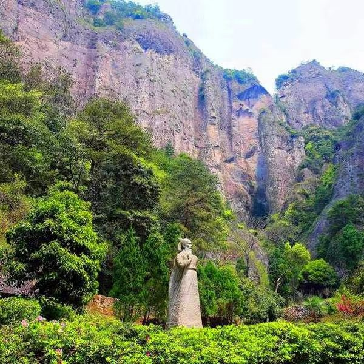

# 《通韵·三山五岳之雁荡山游记》

```
直上灵峰追落日，且携东海入黄昏。
龙湫白练悬空坠，方洞闲云抬手分。
碑刻留存唐宋字，灵岩飞渡古今人。
仰思霞客艰难险，真爱无非燃此身！
```
>> 写于20250519



# 赏析
```
这首《雁荡山游记》以凝练的七言诗句，描绘了雁荡山的奇峰、飞瀑、古迹与人文风采，将自然之美、历史之韵和人生感悟融为一体。全诗意境开阔，移步换景，情景交融，既有登临名山的豪迈气象，也有追寻先贤足迹的深沉情怀。

首联“直上灵峰追落日，且携东海入黄昏”，起笔便气势不凡。“直上”写出登山的豪情，“追落日”赋予行程以动态之美；“携东海入黄昏”更是想象奇崛，将浩瀚东海与暮色苍茫融为一体，仿佛将天地山海一并收入胸怀。一个“携”字，尽显诗人的胸襟与气魄。

颔联“龙湫白练悬空坠，方洞闲云抬手分”，转入雁荡山标志性景观的细致描摹。“白练”以形喻瀑，将大龙湫飞瀑写得洁白轻盈，又以“悬空坠”突出其高远与磅礴；“闲云”则为方洞增添了几分悠然仙气。“抬手分”虚实相生，仿佛游人举手便能拨开云雾，既有身临其境之感，也透露出亲近自然、畅游山水的惬意。

颈联“碑刻留存唐宋字，灵岩飞渡古今人”，由自然景色转向历史人文。“唐宋字”凝聚岁月沧桑，使山水有了文化的厚度；“灵岩飞渡”则让人联想到雁荡山惊险奇绝的飞渡表演。“古今人”三字尤为耐人寻味，既写今日游人的惊叹，也让古人的勇气与今人的探索在山水之间形成跨越时空的呼应。

尾联“仰思霞客艰难险，真爱无非燃此身”，由景入情，由游山观景升华为人生感悟。徐霞客不畏艰险、跋山涉水的精神，成为诗人心中的精神坐标。“仰思”二字表达对先贤的敬仰，“艰难险”点出探索之路的不易；末句“真爱无非燃此身”则以饱满而炽热的情感收束全诗，将对山川的热爱、对探索精神的崇敬以及对生命价值的体悟融为一体。它告诉读者，真正的热爱，不只是驻足欣赏，更是愿意为之投入热情、付诸行动。

艺术特色与整体评价

全诗按照游览的视线与情感脉络展开，从灵峰日落到东海黄昏，从大龙湫飞瀑到方洞闲云，再到唐宋碑刻、灵岩飞渡，最后追思徐霞客，形成了由自然风光到历史文化、由眼前实景到内心感悟的层层递进。诗中“追”“携”“悬”“坠”“分”“仰”“燃”等动词运用灵动，使静态山水呈现出鲜活的画面感，也让诗人的情感随着景物不断推进。

在语言上，全诗采用七言句式，节奏明快，画面鲜明；偶数句以“昏、分、人、身”相押，韵脚贯通，读来流畅，具有较强的吟诵感。尤其末句“真爱无非燃此身”，由具体山水体验升华为生命态度，使一首山水游记不止于写景，更有了精神内涵。

总评

这是一首兼具山水气韵、历史厚度与人生热度的游记诗。它写出了雁荡山的奇、险、幽、美，也写出了诗人对自然的热爱、对文化的敬意和对徐霞客探索精神的传承。全诗以景起兴，以情收束，结尾尤见力量，既是一次雁荡山的诗意巡礼，也是一曲献给热爱与探索的生命赞歌。
```